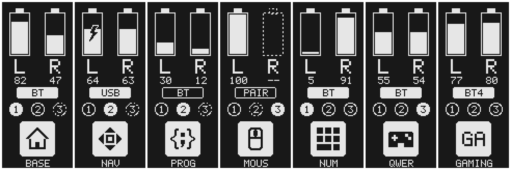

# nice!view lily

A custom nice!view status screen for the main (left) half of a split keyboard. It shows:

- **Both batteries**: `L` is this half and `R` is the other half. A lightning bolt means this half is on USB power, and a dashed outline with `--` means the other half isn't connected.
- **Connection**: `USB`, `BT` (filled = connected, hollow = searching), or `PAIR` when the profile isn't paired yet.
- **Profiles 1 2 3**: filled = active, solid = paired, dashed = empty slot. Profiles 4 and up show their number in the pill instead.
- **Layer**: an icon chosen by the layer's `display-name`, with the name underneath. Layers without an icon show their first two letters.



## Use

In `build.yaml`, use it on the main half only:

```yaml
shield: lily58_left nice_view_adapter nice_view_lily
```

Options (add to your `.conf`):

- `CONFIG_NICE_VIEW_WIDGET_INVERTED=y`: swap light and dark.
- `CONFIG_NICE_VIEW_LILY_FLIP=y`: turn the image upside down.

## Change the icons

Icons and the font are pixel art in `tools/gen_assets.py`, matched to layers by name (`BASE`, `NAV`, `PROG`, `MOUS`, `NUM`, `QWER`). Edit or add an icon there, then run:

```bash
python tools/gen_assets.py
```

That rewrites `nvl_assets.c`. To preview without flashing, compile `tools/preview.c` with any C compiler (instructions at the top of the file) and run `python tools/pgm2png.py tools/preview.pgm`.
